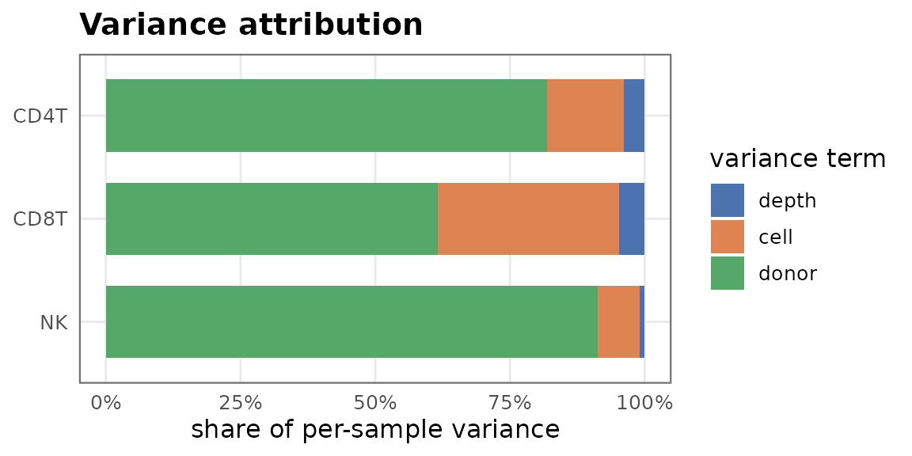
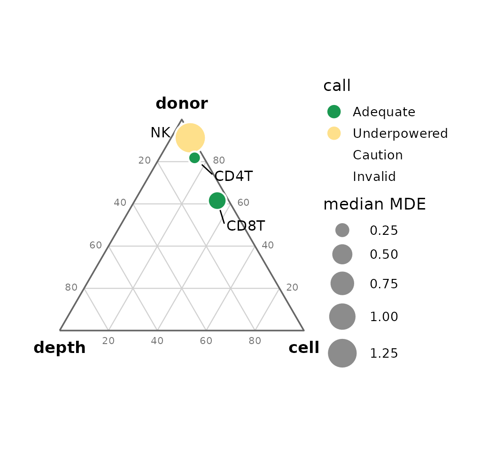
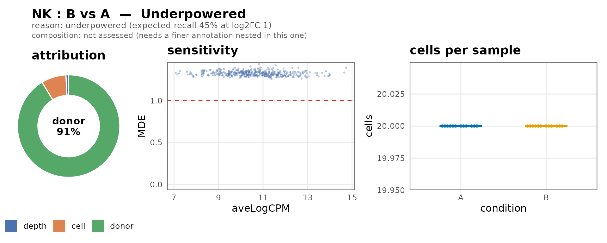

# Assessing pseudobulk DE adequacy with seny

## Installation

`seny` is a Bioconductor package; install it with
*[BiocManager](https://bioconductor.org/packages/3.23/BiocManager)*:

``` r

if (!requireNamespace("BiocManager", quietly = TRUE)) {
    install.packages("BiocManager")
}
BiocManager::install("seny")
```

## What seny does

For every cluster-by-contrast comparison in a multi-sample single-cell
dataset, `seny` decides whether a pseudobulk differential-expression
test is **Adequate**, **Underpowered**, **Caution** or **Invalid**, and
explains why. The diagnostics are analytic and run on your own data;
there is no per-dataset simulation. The variance model and power follow
the DE method you intend to run:
*[edgeR](https://bioconductor.org/packages/3.23/edgeR)* (default),
*[DESeq2](https://bioconductor.org/packages/3.23/DESeq2)* or
*[limma](https://bioconductor.org/packages/3.23/limma)* voom.

The call has a severity order — Invalid \> Caution \> Underpowered \>
Adequate — and a `reason` string that lists *every* flag, so a single
headline never hides a second problem:

| Call | Meaning |
|----|----|
| **Invalid** | Type I error cannot be trusted (design not estimable, too few samples per group). |
| **Caution** | Valid, but a specific risk applies (condition confounded with a covariate, cell-count imbalance tracking the condition under DESeq2, or a subtype shift inside the cluster that would make genes look DE on its own). |
| **Underpowered** | Valid but unable to detect the target effect (sensitivity too low, or too few testable genes). |
| **Adequate** | No flags. |

## The example dataset

`seny` ships a small simulated dataset: 24 donors (12 per condition),
three cell types, each planted in a different regime so the call varies.
A finer annotation, `cell_type_fine`, splits CD4 T into naive and memory
subtypes; we come back to it under *Composition*.

``` r

library(seny)
sce <- readRDS(system.file("extdata", "example_sce.rds", package = "seny"))
table(sce$cell_type, sce$condition)
#> Loading required namespace: SingleCellExperiment
#>       
#>           A    B
#>   CD4T 1080 1080
#>   CD8T  840  180
#>   NK    240  240
```

## Running the assessment

[`assessAll()`](https://smorabit.github.io/seny/reference/assessAll.md)
chains the layers — pseudobulk setup, design/confounding (layer 1),
pseudobulk quality (layer 2), variance structure and sensitivity (layer
4) — and returns one row per comparison.

``` r

res <- assessAll(sce, sample = "donor", group = "condition",
                 annotations = "cell_type", targetLFC = 1)
#> calcNormFactors has been renamed to normLibSizes
#> calcNormFactors has been renamed to normLibSizes
#> calcNormFactors has been renamed to normLibSizes
```

The comparison table carries the layer-2 cell-quality metrics alongside
the call. `cells_cond_cor` is the correlation of log cells-per-sample
with the condition; `cells_ratio` is the smaller group median over the
larger; `expected_recall` is the share of true effects of the target
size the test is expected to detect (mean per-gene power at the target),
and drives the Adequate / Underpowered call.

``` r

cols <- c("cluster", "nA", "nB", "median_cells", "gini_cells", "cells_ratio",
          "cells_cond_cor", "n_testable", "expected_recall", "call")
knitr::kable(as.data.frame(res)[, cols], digits = 2, row.names = FALSE)
```

| cluster | nA | nB | median_cells | gini_cells | cells_ratio | cells_cond_cor | n_testable | expected_recall | call |
|:---|---:|---:|---:|---:|---:|---:|---:|---:|:---|
| CD4T | 12 | 12 | 90.0 | 0.00 | 1.00 | NA | 400 | 1.00 | Adequate |
| CD8T | 12 | 12 | 42.5 | 0.32 | 0.21 | -1 | 400 | 1.00 | Adequate |
| NK | 12 | 12 | 20.0 | 0.00 | 1.00 | NA | 400 | 0.45 | Underpowered |

Each non-adequate call explains itself:

``` r

d <- as.data.frame(res)
for (i in seq_len(nrow(d))) {
    cat(d$cluster[i], "->", as.character(d$call[i]), "::", d$reason[i], "\n")
}
#> CD4T -> Adequate :: adequate 
#> CD8T -> Adequate :: cell-count imbalance correlated with condition (r -1.00, cutoff 0.50 at 24 samples; reported only: edgeR and voom stay calibrated) 
#> NK -> Underpowered :: underpowered (expected recall 45% at log2FC 1)
```

Here CD4 T is clean (**Adequate**). CD8 T has far fewer cells in
condition B, so its cell-count imbalance tracks the condition; seny
reports it in the reason, but the call stays **Adequate** because edgeR
and voom remain calibrated under imbalance. DESeq2 loses FDR control
there, so with `method = "deseq2"` the same comparison is **Caution**:

``` r

res_d <- assessAll(sce, sample = "donor", group = "condition",
                   annotations = "cell_type", targetLFC = 1, method = "deseq2")
as.character(res_d$call[res_d$cluster == "CD8T"])
#> [1] "Caution"
```

NK has high between-donor variance at a modest cell count, so few genes
are detectable at the target effect (**Underpowered**).

## The traffic-light matrix

[`plotAdequacy()`](https://smorabit.github.io/seny/reference/plotAdequacy.md)
renders the table as a clusters-by-contrasts grid, one plot per
annotation set, coloured by the call — the at-a-glance view.

``` r

plots <- plotAdequacy(res)
plots[["cell_type"]]
```


## Reading the diagnostics

A family of plotting functions explains the calls.
[`plotVariance()`](https://smorabit.github.io/seny/reference/plotVariance.md)
shows where each comparison’s noise comes from — the depth, cell and
donor shares of the per-sample variance. A donor-dominated bar means
only more donors will help.

``` r

plotVariance(res)
```



[`plotRegime()`](https://smorabit.github.io/seny/reference/plotRegime.md)
places the same decomposition on one triangle, coloured by the call and
sized by the median detectable effect: position shows where the noise
is, size shows how hard detection is.

``` r

plotRegime(res)
```



[`plotComparison()`](https://smorabit.github.io/seny/reference/plotComparison.md)
assembles a single comparison — the call and its reason, the variance
donut, the sensitivity curve and the cells per sample — into one card.

``` r

plotComparison(res, "cell_type:NK:B_vs_A")
```



Other views:
[`plotConfounding()`](https://smorabit.github.io/seny/reference/plotConfounding.md)
(Layer-1 association),
[`plotCells()`](https://smorabit.github.io/seny/reference/plotCells.md)
(cells per sample by condition),
[`plotSensitivity()`](https://smorabit.github.io/seny/reference/plotSensitivity.md)
(detectable effect vs expression) and
[`plotPower()`](https://smorabit.github.io/seny/reference/plotPower.md)
(power vs effect size).

## Composition: subtype shifts inside a cluster

A broad cluster often holds subtypes, and their shares can differ
between the conditions. Pseudobulk DE on the broad cluster then reports
the subtypes’ marker genes as DE although no gene changes within any
subtype. CD4 T looked **Adequate** above, but its naive and memory
subtypes shift with the condition:

``` r

table(sce$cell_type_fine, sce$condition)
#>             
#>                A   B
#>   CD4 memory 432 708
#>   CD4 naive  648 372
#>   CD8T       840 180
#>   NK         240 240
```

Give
[`assessAll()`](https://smorabit.github.io/seny/reference/assessAll.md)
both annotation levels. `seny` works out which level nests in which from
the cells, and for each broad cluster:

- tests the subtypes’ shares of the cluster with propeller from
  *[speckle](https://bioconductor.org/packages/3.23/speckle)*;
- predicts, per gene, the log2 fold change the observed shift alone
  would cause, and the power to call it DE, which sums to the number of
  DEGs expected from composition alone;
- labels each DEG of the broad cluster’s own test as
  *composition-driven*, *within-child DE*, *mixed* or *unresolved*, by
  comparing the observed change with the prediction and checking whether
  any subtype shows the gene as DE.

``` r

res2 <- assessAll(sce, sample = "donor", group = "condition",
                  annotations = c("cell_type", "cell_type_fine"), targetLFC = 1)
#> calcNormFactors has been renamed to normLibSizes
#> calcNormFactors has been renamed to normLibSizes
#> calcNormFactors has been renamed to normLibSizes
#> calcNormFactors has been renamed to normLibSizes
#> calcNormFactors has been renamed to normLibSizes
#> calcNormFactors has been renamed to normLibSizes
#> calcNormFactors has been renamed to normLibSizes
d2 <- as.data.frame(res2)
cols <- c("annotation", "cluster", "call", "composition", "comp_child",
          "exp_comp_deg", "n_parent_deg", "n_comp_driven")
knitr::kable(d2[d2$annotation == "cell_type", cols], digits = 2, row.names = FALSE)
```

| annotation | cluster | call | composition | comp_child | exp_comp_deg | n_parent_deg | n_comp_driven |
|:---|:---|:---|:---|:---|---:|---:|---:|
| cell_type | CD4T | Caution | assessed | CD4 memory | 44.36 | 70 | 40 |
| cell_type | CD8T | Adequate | single child | NA | NA | NA | NA |
| cell_type | NK | Underpowered | single child | NA | NA | NA | NA |

``` r

d2$reason[d2$comparison == "cell_type:CD4T:B_vs_A"]
#> [1] "composition shift within the cluster (CD4 memory 40% -> 66%, FDR 0): ~44 genes (11.1%) expected to look DE from the shift alone"
```

CD4 T is now **Caution**: the memory share rises from about 40% to 66%,
enough to make about 44 genes look DE at the broad level.
[`plotComposition()`](https://smorabit.github.io/seny/reference/plotComposition.md)
shows the shift and which of the cluster’s DEGs it explains:
composition-driven genes sit on the diagonal, while the genes that
really change inside the subtypes do not.

``` r

plotComposition(res2, "cell_type:CD4T:B_vs_A")
```


What to do with a composition Caution: test the subtypes separately
(their own calls are in the same table), or interpret the broad
cluster’s DEGs with the attribution in hand. A cluster whose overall
share differs between conditions is reported (`share_A`, `share_B`,
`share_fdr`) but not flagged, since that alone does not bias DE within
it. With a single annotation level the composition is `"not assessed"`.

## Thresholds and honest reporting

The numeric cut-offs that drive the call live in
[`defaultThresholds()`](https://smorabit.github.io/seny/reference/defaultThresholds.md)
and can be overridden. They are **provisional placeholders** — the final
values are being derived from a validation study (OneK1K, AIDA and an
in-house atlas), not chosen up front.

``` r

str(defaultThresholds())
#> List of 10
#>  $ cramerV       : num 0.3
#>  $ vif           : num 5
#>  $ sensitivity   : num 0.5
#>  $ minSamples    : num 2
#>  $ cellsCondCor  : num 0.5
#>  $ cellsCondAlpha: num 0.05
#>  $ minTestable   : num 200
#>  $ compFDR       : num 0.05
#>  $ compFrac      : num 0.01
#>  $ compExplained : num 0.5
```

This run assessed 3 comparisons. When you scan many comparisons at once,
treat the matrix as a screen, not a ranking: picking the standout cell
after the fact inflates false positives. The call tells you which
comparisons are *worth* testing — it does not replace multiple-testing
control across them.

``` r

sessionInfo()
#> R version 4.6.2 (2026-10-29)
#> Platform: x86_64-pc-linux-gnu
#> Running under: Ubuntu 26.04.1 LTS
#> 
#> Matrix products: default
#> BLAS:   /usr/lib/x86_64-linux-gnu/openblas-pthread/libblas.so.3 
#> LAPACK: /usr/lib/x86_64-linux-gnu/openblas-pthread/libopenblasp-r0.3.32.so;  LAPACK version 3.12.0
#> 
#> locale:
#>  [1] LC_CTYPE=C.UTF-8       LC_NUMERIC=C           LC_TIME=C.UTF-8       
#>  [4] LC_COLLATE=C.UTF-8     LC_MONETARY=C.UTF-8    LC_MESSAGES=C.UTF-8   
#>  [7] LC_PAPER=C.UTF-8       LC_NAME=C              LC_ADDRESS=C          
#> [10] LC_TELEPHONE=C         LC_MEASUREMENT=C.UTF-8 LC_IDENTIFICATION=C   
#> 
#> time zone: UTC
#> tzcode source: system (glibc)
#> 
#> attached base packages:
#> [1] stats     graphics  grDevices utils     datasets  methods   base     
#> 
#> other attached packages:
#> [1] seny_0.99.0      BiocStyle_2.40.0
#> 
#> loaded via a namespace (and not attached):
#>   [1] RColorBrewer_1.1-3          jsonlite_2.0.0             
#>   [3] magrittr_2.0.5              ggbeeswarm_0.7.3           
#>   [5] spatstat.utils_3.2-5        farver_2.1.2               
#>   [7] rmarkdown_2.32              fs_2.1.0                   
#>   [9] ragg_1.5.2                  vctrs_0.7.3                
#>  [11] ROCR_1.0-12                 spatstat.explore_3.8-3     
#>  [13] DelayedMatrixStats_1.34.0   htmltools_0.5.9            
#>  [15] S4Arrays_1.12.1             SparseArray_1.12.3         
#>  [17] sass_0.4.10                 sctransform_0.4.3          
#>  [19] parallelly_1.50.0           KernSmooth_2.23-27         
#>  [21] bslib_0.12.0                htmlwidgets_1.6.4          
#>  [23] desc_1.4.3                  ica_1.0-3                  
#>  [25] plyr_1.8.9                  speckle_1.12.0             
#>  [27] plotly_4.12.1               zoo_1.9-1                  
#>  [29] cachem_1.1.0                igraph_2.3.4               
#>  [31] mime_0.13                   lifecycle_1.0.5            
#>  [33] pkgconfig_2.0.3             Matrix_1.7-6               
#>  [35] R6_2.6.1                    fastmap_1.2.0              
#>  [37] MatrixGenerics_1.24.0       fitdistrplus_1.2-6         
#>  [39] future_1.82.0               shiny_1.14.0               
#>  [41] digest_0.6.39               patchwork_1.3.2            
#>  [43] S4Vectors_0.50.3            DESeq2_1.52.0              
#>  [45] tensor_1.5.1                Seurat_5.6.0               
#>  [47] RSpectra_0.16-2             irlba_2.4.1                
#>  [49] textshaping_1.0.5           GenomicRanges_1.64.0       
#>  [51] beachmat_2.28.0             labeling_0.4.3             
#>  [53] progressr_1.1.0             spatstat.sparse_3.2-0      
#>  [55] polyclip_1.10-7             httr_1.4.9                 
#>  [57] abind_1.4-8                 compiler_4.6.2             
#>  [59] withr_3.0.3                 S7_0.2.2                   
#>  [61] BiocParallel_1.46.0         fastDummies_1.7.6          
#>  [63] MASS_7.3-66                 DelayedArray_0.38.2        
#>  [65] tools_4.6.2                 vipor_0.4.7                
#>  [67] lmtest_0.9-40               otel_0.2.0                 
#>  [69] beeswarm_0.4.0              httpuv_1.6.17              
#>  [71] future.apply_1.21.0         goftest_1.2-3              
#>  [73] glmGamPoi_1.24.0            glue_1.8.1                 
#>  [75] nlme_3.1-171                promises_1.5.0             
#>  [77] grid_4.6.2                  Rtsne_0.17                 
#>  [79] cluster_2.1.8.3             reshape2_1.4.5             
#>  [81] generics_0.1.4              spatstat.data_3.1-9        
#>  [83] gtable_0.3.6                tidyr_1.3.2                
#>  [85] data.table_1.18.6.1         sp_2.2-4                   
#>  [87] XVector_0.52.0              spatstat.geom_3.8-3        
#>  [89] BiocGenerics_0.58.1         RcppAnnoy_0.0.23           
#>  [91] stringr_1.6.0               ggrepel_0.9.8              
#>  [93] RANN_2.6.3                  pillar_1.11.1              
#>  [95] spam_2.11-4                 RcppHNSW_0.7.0             
#>  [97] limma_3.68.5                later_1.4.8                
#>  [99] splines_4.6.2               dplyr_1.2.1                
#> [101] lattice_0.23-1              deldir_2.0-4               
#> [103] survival_3.8-12             tidyselect_1.2.1           
#> [105] SingleCellExperiment_1.34.0 locfit_1.5-9.12            
#> [107] miniUI_0.1.2                pbapply_1.7-5              
#> [109] knitr_1.52                  gridExtra_2.3.1            
#> [111] bookdown_0.48               IRanges_2.46.0             
#> [113] Seqinfo_1.2.0               edgeR_4.10.7               
#> [115] SummarizedExperiment_1.42.0 scattermore_1.2            
#> [117] stats4_4.6.2                xfun_0.62                  
#> [119] Biobase_2.72.0              statmod_1.5.2              
#> [121] matrixStats_1.5.0           stringi_1.8.9              
#> [123] yaml_2.3.12                 evaluate_1.0.5             
#> [125] codetools_0.2-20            tibble_3.3.1               
#> [127] BiocManager_1.30.27         cli_3.6.6                  
#> [129] uwot_0.2.5                  xtable_1.8-8               
#> [131] reticulate_1.47.0           systemfonts_1.3.2          
#> [133] jquerylib_0.1.4             Rcpp_1.1.2                 
#> [135] spatstat.random_3.5-2       globals_0.20.0             
#> [137] png_0.1-9                   spatstat.univar_3.2-0      
#> [139] parallel_4.6.2              pkgdown_2.2.1              
#> [141] ggplot2_4.0.3               dotCall64_1.2              
#> [143] sparseMatrixStats_1.24.0    listenv_1.1.0              
#> [145] viridisLite_0.4.3           scales_1.4.0               
#> [147] ggridges_0.5.7              SeuratObject_5.4.0         
#> [149] purrr_1.2.2                 rlang_1.3.0                
#> [151] cowplot_1.2.0
```
